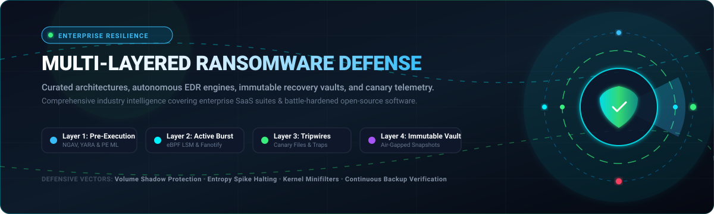

# 🛡️ Awesome Multi-Layered Ransomware Defense 🚀

  

  
  
  
  
  
  
  

> 🌐 **A curated index of premier Multi-Layered Ransomware Defense platforms, endpoint detection and response (EDR/XDR) architectures, behavioral heuristic engines, and immutable disaster recovery vaults.** Built for CISOs, SecOps engineers, blue teams, and system administrators defending modern hybrid infrastructure against extortion malware.
> 🌟 *Star this repository if you find it valuable for your cybersecurity engineering and incident response stack!* 🌟

---

## 🧭 Executive Summary & SEO Keywords 🔍

- **Core Defense Vectors:** Anti-Ransomware Platforms, Multi-Layered Cyber Resilience, Endpoint Detection and Response (EDR), Extended Detection and Response (XDR), eBPF Linux Security Modules (BPF LSM), Windows Kernel Minifilter Drivers.
- **Integrity & Vaulting:** Immutable Object Storage, Air-Gapped Snapshots, Volume Shadow Copy Protection (VSS Guard), File Integrity Monitoring (FIM), Honeypot Canaries, Cryptographic Hash Verification.
- **Target Environments:** Cloud Workloads (AWS, Azure, GCP), Kubernetes & Containers, Linux Enterprise Servers, Windows Server & Active Directory Domains, macOS Fleet Endpoints.

---

## 📋 Table of Contents 📑

- [📈 Sector Overview & Market Dynamics](#-sector-overview--market-dynamics)
- [🟦 SaaS / Commercial Enterprise Platforms](#-saas--commercial-enterprise-platforms)
- [🟩 Open-Source Software & Defensive Tooling](#-open-source-software--defensive-tooling)
- [📊 Architectural Comparison at a Glance](#-architectural-comparison-at-a-glance)
- [📈 Star History](#-star-history)
- [💖 Support & Sponsorship](#-support--sponsorship)
- [🤝 Contributing & Community Standards](#-contributing--community-standards)
- [📄 License](#-license)

---

## 📈 Sector Overview & Market Dynamics 📊

The global **Ransomware Protection and Cyber Resilience market** is estimated at **$32.5 billion in 2026** and projected to surpass **$115 billion by 2034**, expanding at a Compound Annual Growth Rate (CAGR) of **15.4%**. 

From an industry structure perspective, the market exhibits a **moderately concentrated yet hybrid dynamic**:
- **Consolidated Enterprise Tier:** Top-tier conglomerate vendors (**CrowdStrike, SentinelOne, Rubrik, Veeam, Cohesity, Commvault, Microsoft, Palo Alto Networks**) capture the bulk of enterprise budget through integrated, all-in-one XDR ecosystems and enterprise cloud-vaulting suites where vendor lock-in and cyber-insurance underwriting standards favor comprehensive institutional platforms.
- **Fragmented Innovation Tier:** Concurrently, rapid proliferation of Ransomware-as-a-Service (RaaS) operations, intermittent encryption evasion, and hyper-targeted extortion campaigns maintain a **highly fragmented niche ecosystem** of specialized behavioral daemons, kernel-level eBPF interceptors, canary tripwire services, and open-source backup integrity monitors.

---

## 🟦 SaaS / Commercial Enterprise Platforms ☁️

The following tabular overview catalogs market-leading SaaS and hosted commercial multi-layered ransomware defense platforms. The table is strictly sorted in descending order by enterprise scale (Valuation / Market Capitalization).

| Platform / Vendor 🏢 | Scale (Valuation / Market Cap) 💰 | Pricing (Starting Paid Tier) 🏷️ | Free Tier / Evaluation Limits ⏳ | Key Defensive Focus 🛡️ |
| :--- | :--- | :--- | :--- | :--- |
| **CrowdStrike Falcon** 🦅 | ~$232 Billion Market Cap *(Public: NASDAQ: CRWD)* | **$7.99 / device / month** *(Falcon Go, billed annually at $59.99/device/yr)* | **15-day free trial** *(Full access to Falcon Prevent NGAV, Device Control, and USB protection; up to 100 endpoints; no credit card required)* | AI-native endpoint protection, Real-Time Response (RTR), adversary threat intelligence, and cloud workload security. |
| **Rubrik Security Cloud** 🔐 | ~$23 Billion Market Cap *(Public: NYSE: RBRK)* | **~$130 / TB / month** *(Base Foundation tier licensing on AWS Marketplace; multi-year enterprise commitments available)* | **30-day proof-of-concept (PoC)** *(Scoped enterprise sandbox evaluation via sales engineering or AWS Marketplace private offer)* | Zero-trust cyber recovery, immutable backups, YARA backup threat monitoring, and Turbo Threat Hunting across snapshots. |
| **Veeam Data Platform** 💾 | ~$15 Billion Valuation *(Private / Insight Partners)* | **$155 / workload / year** *(Foundation VUL subscription; sold in minimum packs of 10 workloads)* | **Permanently Free Community Edition** *(Up to 10 workloads forever with full backup & recovery; 30-day unrestricted Enterprise trial included upon download)* | Enterprise data resilience, immutable Linux backup repositories, AI-assisted threat analysis, and instant VM disaster recovery. |
| **SentinelOne Singularity** ⚡ | ~$7.7 Billion Market Cap *(Public: NYSE: S)* | **$69.99 / endpoint / year** *(Singularity Core, approx. $5.83/endpoint/mo; Singularity Control at $79.99/yr)* | **14 to 30-day free trial** *(Provisioned enterprise trial/PoC via direct request or authorized MSSP partner; no automatic credit card billing)* | Autonomous behavioral AI, 1-click ransomware rollback to unencrypted snapshots, Storyline process tree visualization. |
| **Cohesity ThreatDefense** 🛡️ | ~$7.5 Billion Valuation *(Private enterprise)* | **~$150 / Front-End TB / year** *(Enterprise software subscription; BaaS options scale by capacity and retention)* | **30-day free trial** *(Cohesity Data Cloud / Backup-as-a-Service hands-on evaluation for hybrid VMs and SaaS workloads)* | Multi-cloud data security platform, SmartFiles immutability, AI-driven threat defense, and isolated FortKnox cyber vaulting. |
| **Commvault Cloud** 🌐 | ~$7.2 Billion Market Cap *(Public: NASDAQ: CVLT)* | **$1.70 / user / month** *(Microsoft 365 SaaS protection; file/object cloud storage protection starts at ~$58.50/TB/mo)* | **30-day free trial** *(Self-service trial covering virtual machines, databases, Kubernetes, and SaaS applications with no credit card required)* | Autonomous recovery, AI-powered Threat Scan anomaly detection, cleanroom recovery testing, and air-gapped Cloud Command. |
| **Druva Data Defense** ☁️ | ~$2.0 Billion Valuation *(Private enterprise)* | **$4.00 / user / month** *(End-user SaaS/app backup; Data Center server workloads start at ~$210/TB/month consumption credit)* | **30-day free trial** *(Full platform functionality across endpoints, Microsoft 365, and AWS infrastructure workloads)* | 100% SaaS serverless data protection, air-gapped Druva Cloud storage, zero-hardware ransomware recovery, and remote data wipe. |

---

## 🟩 Open-Source Software & Defensive Tooling 💻

Self-hosted, community-driven tools protecting against ransomware across kernel I/O, userland daemons, canary tripwires, and backup verification. Repositories are strictly sorted in descending order by GitHub community star count.

| Project & Repository 📦 | GitHub Stars 🌟 | Stack & Environment ⚙️ | Detection & Enforcement Mechanism 🔍 | Key Defensive Layer 🛡️ |
| :--- | :--- | :--- | :--- | :--- |
| **[restic](https://github.com/restic/restic)** 🔒 |  | Go / Multi-Platform | Cryptographically verified snapshots, client-side AES-256 encryption, append-only immutable repository flags. | **Layer 4: Immutable Vault** Guarantees untampered, ransomware-proof snapshot recovery across offsite object storage and cold repositories. |
| **[Wazuh](https://github.com/wazuh/wazuh)** 🛡️ |  | C / Python / Multi-Platform | File Integrity Monitoring (FIM), behavioral anomaly detection, real-time command execution blocking, log analysis. | **Layer 1 & 2: SIEM & Active Response** Comprehensive open-source XDR agent executing automated process termination and network isolation. |
| **[BushidoUK/Ransomware-Tool-Matrix](https://github.com/BushidoUK/Ransomware-Tool-Matrix)** 🗺️ |  | Markdown / Threat Intel | Exhaustive MITRE ATT&CK mapping of operational tools, loaders, and exfiltration software used by 100+ active ransomware gangs. | **Layer 0: Threat Intelligence** Essential detection engineering baseline for validating whether your defensive sensors detect active ransomware tooling. |
| **[Neo23x0/Raccine](https://github.com/Neo23x0/Raccine)** 💉 |  | C++ / Windows (Registry/IFEO) | Intercepts attempts to delete Volume Shadow Copies via `vssadmin`, `wbadmin`, `bcdedit`, or `powershell` using Image File Execution Options. | **Layer 1: Pre-Execution Tripwire** Kills offending parent processes before ransomware can eliminate local Windows recovery shadow snapshots. |
| **[Decryptonite](https://github.com/DecryptoniteTeam/Decryptonite)** 🗝️ |  | Python / Multi-Platform | Real-time mass-encryption activity detection, heuristic entropy analysis, process containment, and automated decryption mitigation. | **Layer 2: Behavioral Interception** Stops rapid unauthorized file transformation and preserves uncorrupted copies for immediate restore. |
| **[RafWu/RansomWatch](https://github.com/RafWu/RansomWatch)** 👁️ |  | C++ / C / Windows Kernel | Windows Minifilter Driver monitoring raw file system I/O, detecting encryption burst write rates, and killing malicious processes. | **Layer 2: Kernel Minifilter** Low-level kernel driver defense operating under the Windows Filter Manager to intercept file-locker malware. |
| **[TomasPhilippart/ebpfangel](https://github.com/TomasPhilippart/ebpfangel)** 🐝 |  | C (eBPF) / Python / Linux | Machine learning classifier paired with Linux eBPF kernel probes for real-time anomalous file system event detection. | **Layer 2: eBPF Kernel Probes** Zero-overhead kernel event tracing without modifying kernel binaries or loading risky out-of-tree kernel modules. |
| **[nextcloud/ransomware_protection](https://github.com/nextcloud/ransomware_protection)** ☁️ |  | PHP / Nextcloud Ecosystem | File upload scanner matching extension fingerprints, known ransomware naming conventions, and automated locking triggers. | **Layer 3: Storage Gateway Guard** Prevents compromised client workstations from synchronizing encrypted or renamed files into private enterprise clouds. |
| **[ShadowStrike](https://github.com/ShadowStrike-Labs/ShadowStrike)** 👻 |  | C++ / C / Windows Kernel | `PhantomSensor` WDM minifilter driver, CPU emulator sandbox (`PhantomEmulator`), canary file tripwires, and PE ML classification. | **Layer 2: Open-Source EDR** Auditable Windows endpoint security engine featuring kernel I/O callbacks and sacrificial decoy monitoring. |
| **[BushidoUK/Awesome-Ransomware](https://github.com/BushidoUK/Awesome-Ransomware)** 📚 |  | Markdown / Security Wiki | Curated index of academic ransomware analysis papers, decryption tools, prevention blueprints, and post-incident playbooks. | **Layer 0: Research & Reference** Broad reference manual for incident responders studying ransomware binary internals and evasion tactics. |
| **[talus-process-monitor](https://github.com/Hartwell-Labs/talus-process-monitor)** 🔬 |  | Rust / eBPF / Linux | Static binary eBPF agent tracking rapid write entropy and process bursts; executes instant SIGSTOP or SIGKILL containment. | **Layer 2: Linux Autonomous Containment** Single-binary deployment that pauses ransomware processes mid-burst without requiring system reboots. |
| **[Warden](https://github.com/Spellskite-coding/Warden)** 🛡️ |  | Rust / Linux (fanotify / GTK4) | Filesystem-wide fanotify monitoring, multi-counter burst tracking (per-PID, per-dir, global), YARA scanning, and `pkexec` gating. | **Layer 2: Workstation EDR** Adversarially hardened Linux desktop EDR with quarantine locking and protection against package-manager spoofing. |
| **[Sentinel Antivirus](https://github.com/mukti-sys/sentinel-antivirus)** 🎯 |  | C++ / Python / Windows | 5-tier triage pipeline: SHA-256 deduplication, Authenticode verification, YARA matching, PE ML inference, zero-byte canary decoys. | **Layer 1 & 3: NGAV & Decoy Tripwire** Lightweight Windows antivirus deploying sacrificial files to trigger immediate process suspension upon modification. |
| **[RansomShield](https://github.com/Spellskite-coding/RansomShield)** ⚡ |  | Rust / Linux (fanotify) | High-speed fanotify daemon combining entropy scoring, burst limits, and honeypot traps; tested across 5 distributions. | **Layer 2 & 3: Server Protection Daemon** Kills encryption processes within 8 files; directory-baseline gate prevents false alarms during legitimate backups. |
| **[Bouclier Bleu](https://github.com/alexandreboutrik/bouclier-bleu)** 🛡️ |  | Rust / eBPF (BPF LSM) / Linux | BPF LSM kernel enforcement, `rename_entropy` tracking, `strict_wx` memory protection, and NDJSON telemetry for SIEMs. | **Layer 2: Next-Gen eBPF Antivirus** Modular kernel-level LSM engine blocking memory injection and filesystem encryption at native kernel speeds. |
| **[endpoint-security-ai-agent](https://github.com/MuthoniGathiithi/endpoint-security-ai-agent)** 🤖 |  | Python / FastAPI / Next.js | osquery telemetry engine, machine learning heuristic scoring, auto-kill host isolation, and conversational AI incident copilot. | **Layer 1 & 2: AI EDR Dashboard** Modern containerized AI analyst dashboard providing natural language triage of ransomware telemetry. |
| **[AEGIS SOC Platform](https://github.com/ErfanSaraee/aegis-autonomous-soc-platform)** ⚡ |  | Python / FastAPI / Next.js | Autonomous 7-node LangGraph agent, autoencoder anomaly detection, deterministic containment playbooks, and honeypots. | **Layer 1 & 2: Autonomous SOAR** Automated incident containment executing deterministic playbooks to isolate endpoints and block lateral movement. |
| **[VaultSentry](https://github.com/Egyan07/VaultSentry)** 🗄️ |  | Python / Tkinter | Automated cryptographic file hashing, named snapshot generation, diff analysis, and daily HTML backup health digests. | **Layer 4: Backup Integrity Monitor** Detects silent backup encryption, unauthorized file modification, and abrupt size drops with 1-click restore. |
| **[shadow-copy-guard](https://github.com/mrezwanulbari/ransomware-defense-framework/tree/main/tooling/shadow-copy-guard)** 🛡️ |  | PowerShell / Python / Bash | Monitored command parser intercepting deletion commands aimed at volume shadow copies, system state, and catalog records. | **Layer 1: Pre-Execution Prevention** Operationalizes anti-evasion defenses inspired by Raccine for both Linux and Windows environments. |
| **[backup-integrity-checker](https://github.com/mrezwanulbari/ransomware-defense-framework/tree/main/tooling/backup-integrity-checker)** 🔍 |  | Shell / Python / Manifest | Automated checksum and manifest validation engine testing backup directories for tampering, truncation, or missing snapshots. | **Layer 4: Recovery Governance** Validates backup freshness and cryptographic integrity to ensure clean, malware-free recovery targets. |

---

## 📊 Architectural Comparison at a Glance 🔍

| Solution 💻 | Deployment Type ☁️ | Primary Detection Vector 🎯 | Response Action ⚡ | Recovery Assurance 💾 | Self-Hosted 🏠 | Target Architecture 🎯 |
| :--- | :--- | :--- | :--- | :--- | :--- | :--- |
| **CrowdStrike Falcon** | SaaS Cloud | ML + Threat Intel + Indicators of Attack (IOA) | Real-Time Response (RTR) & Host Isolation | Secondary (Relies on clean enterprise backup) | ❌ No | Enterprise Hybrid Fleets |
| **Rubrik Security Cloud** | SaaS + Cloud/Edge Appliance | YARA Rules + Behavioral Snapshot Anomaly Analysis | Automated File Quarantine & Access Revocation | ✅ Native Zero-Trust Immutable Snapshots | ⚠️ Appliance | Enterprise Disaster Recovery |
| **Veeam Data Platform** | SaaS / Self-Managed Hybrid | Inline AI Malware Scanners & Threat Intelligence | Automated Alerting & Incident Isolation | ✅ Native Hardened Linux Immutable Storage | ✅ Yes | Virtual & Physical Infrastructure |
| **SentinelOne Singularity** | SaaS Cloud | Behavioral AI & Storyline Process Telemetry | Automated Process Kill & OS Rollback | ✅ 1-Click File Shadow Rollback | ❌ No | Enterprise Endpoints & Cloud |
| **Cohesity ThreatDefense** | SaaS / Hybrid Cloud | Machine Learning Entropy & Anomaly Detection | Automated Workflow Isolation & Alerting | ✅ Air-Gapped FortKnox Cyber Vaulting | ⚠️ Hybrid | Enterprise Secondary Storage |
| **Commvault Cloud** | SaaS Cloud | Machine Learning Risk Scoring & Anomaly Scans | Host Isolation & Synthetic Recovery | ✅ Air-Gapped Cleanroom Recovery | ❌ No | Cloud & SaaS Applications |
| **Druva Data Defense** | 100% Cloud SaaS | Behavioral Anomaly Heuristics & Hash Matching | Network Isolation & Remote Endpoint Wipe | ✅ Air-Gapped Deduplicated Cloud Storage | ❌ No | Distributed Workstations & M365 |
| **restic** | Open Source CLI | Cryptographic SHA-256 Repository Verification | Read-Only Snapshot Locks (Append-Only) | ✅ Cryptographically Verified Restore Points | ✅ Yes | Servers, Desktops & Cloud |
| **Wazuh** | Open Source Platform | File Integrity Monitoring (FIM) & Rule Engine | Active Response Script Execution (Kill/Block) | ⚠️ External Script Driven | ✅ Yes | Multi-Platform Endpoints & Cloud |
| **Neo23x0/Raccine** | Open Source Utility | Registry IFEO Interception of VSS Deletion Tools | Immediate Process Kill of Precursor Commands | ✅ Preserves Local Volume Shadow Copies | ✅ Yes | Windows Workstations & Servers |
| **Decryptonite** | Open Source Software | File System Entropy Spikes & Extension Renaming | Process Suspension & Rollback Restoration | ✅ Preserves Cached File Copies | ✅ Yes | Desktops & Local Storage |
| **RafWu/RansomWatch** | Open Source Driver | Windows Minifilter Driver File I/O Monitoring | Automated Process Termination | ⚠️ Relies on System Backups | ✅ Yes | Windows Kernel Endpoints |
| **TomasPhilippart/ebpfangel**| Open Source Agent | eBPF Linux Kernel Probes + ML Classification | Kernel-Level Event Logging & Alerts | ⚠️ Relies on System Backups | ✅ Yes | Linux Server Infrastructure |
| **nextcloud/ransomware_prot** | Open Source Plugin | Upload Fingerprinting & Extension Blocklists | Upload Rejection & Account Alerting | ✅ Preserves Nextcloud File Versions | ✅ Yes | Nextcloud Private Clouds |
| **ShadowStrike** | Open Source Framework | Minifilter Callbacks, CPU Emulation, Canaries | Process Suspension & Quarantining | ⚠️ Sandbox Rollback | ✅ Yes | Windows Security Research |
| **Hartwell-Labs/talus** | Open Source Agent | eBPF Burst Scoring & High-Entropy Writing | Automated SIGSTOP / SIGKILL Process Halting | ⚠️ Relies on File Snapshots | ✅ Yes | Linux Containers & Servers |
| **RansomShield** | Open Source Daemon | fanotify Burst Detection & Honeypot Tripwires | Process Kill within 8 Files & Quarantine | ✅ Quarantined Original File Restoration | ✅ Yes | Linux Server Infrastructure |
| **Warden** | Open Source EDR | fanotify Burst Rates, YARA Rules & Honeypots | Process Termination & Setuid-Stripped Isolation | ✅ Quarantined File Restoration | ✅ Yes | Linux Desktop Workstations |
| **Sentinel Antivirus** | Open Source Antivirus | PE ML Inference (EMBER) & Decoy Canary Traps | Process Suspension & Driver-Level Interception | ⚠️ Decoy Quarantine | ✅ Yes | Windows Client Environments |
| **Bouclier Bleu** | Open Source NGAV | BPF LSM Kernel Enforcement & Memory Shields | Kernel-Level System Call Interception | ⚠️ SIEM Alert Driven | ✅ Yes | Modern Linux (Kernel 5.12+) |
| **endpoint-security-ai-agent**| Open Source EDR | osquery Telemetry & ML Anomaly Analytics | Host Network Isolation & Process Kill | ⚠️ Local Quarantine | ✅ Yes | Containerized Fleets |
| **AEGIS SOC Platform** | Open Source SOAR | Autoencoder Anomaly Scoring & Playbooks | Automated SOAR Endpoint Containment | ⚠️ Playbook Dependent | ✅ Yes | SOC Operations & Multi-Cloud |
| **VaultSentry** | Open Source Monitor | Nightly Cryptographic Hash Comparison & Diffing | Anomaly Flagging & Digest Alerting | ✅ 1-Click GUI Snapshot Restoration | ✅ Yes | On-Premise Backup Directories |
| **shadow-copy-guard** | Open Source Script | Command-Line Pattern Interception | Immediate Process Termination | ✅ Prevents Deletion of Local Snapshots | ✅ Yes | Linux & Windows Systems |
| **backup-integrity-checker** | Open Source Checker | Hash Manifest Cross-Validation & Freshness | Automated Alerting & Governance Logging | ✅ Guarantees Recovery Manifest Health | ✅ Yes | Backup Repositories & Disks |

---

##  Star History

---

## 💖 Support & Sponsorship ☕

Thank you for visiting and using this curated multi-layered ransomware defense guide! 🙌

If this project has saved you research hours, helped you harden your enterprise endpoints, or assisted in designing your immutable backup strategy, please consider supporting the project:

- ⭐ **Star the repository** on GitHub to boost visibility and help others discover it.
- 🍴 **Fork and share** this curated list with your team, peers, and InfoSec communities.
- ☕ **Buy me a coffee & sponsor development**: Support ongoing maintenance, fact-checking, and threat research via the [GitHub Sponsors Dashboard](https://github.com/sponsors/ishandutta2007).

Every bit of support helps keep this guide comprehensive, up-to-date, and completely open-source! ❤️

---

## 🤝 Contributing & Community Standards 💡

Contributions from cybersecurity professionals, blue-team operators, open-source maintainers, and security researchers are warmly welcomed! 

To submit a new open-source ransomware defense tool, behavioral engine, or commercial resilience platform, please review our contribution guidelines:

1. **Active Maintenance:** The repository or project must demonstrate active maintenance (commits, updates, or vendor releases within the last 12 months).
2. **Defensive Relevance:** The project must address one or more layers of ransomware defense (prevention, tripwires, behavioral detection, kernel monitoring, or immutable recovery).
3. **Factual Formatting:** Ensure entries include project name, official GitHub repository URL, primary language stack, license, and a concise summary of its detection/mitigation capabilities.
4. **Pull Request Protocol:** Fork this repository, create a descriptive feature branch (e.g. `feature/add-ebpf-detector`), apply changes cleanly, and submit a PR.

---

## 📄 License 📜

To the extent possible under law, the author(s) have dedicated all copyright and related neighboring rights to this repository to the public domain worldwide under the terms of the **[Creative Commons CC0 1.0 Universal Public Domain Dedication (CC0 1.0)](LICENSE)**.

You can copy, modify, distribute, and perform the work, even for commercial purposes, all without asking permission. Software products and repositories referenced within this list remain subject to their respective intellectual property rights and licenses.

---

  ⭐ <b>If this defensive compilation helped strengthen your cybersecurity posture, please star the repository!</b> ⭐

